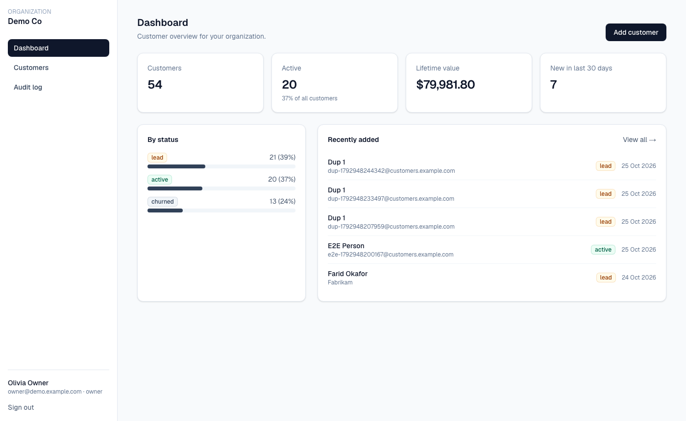
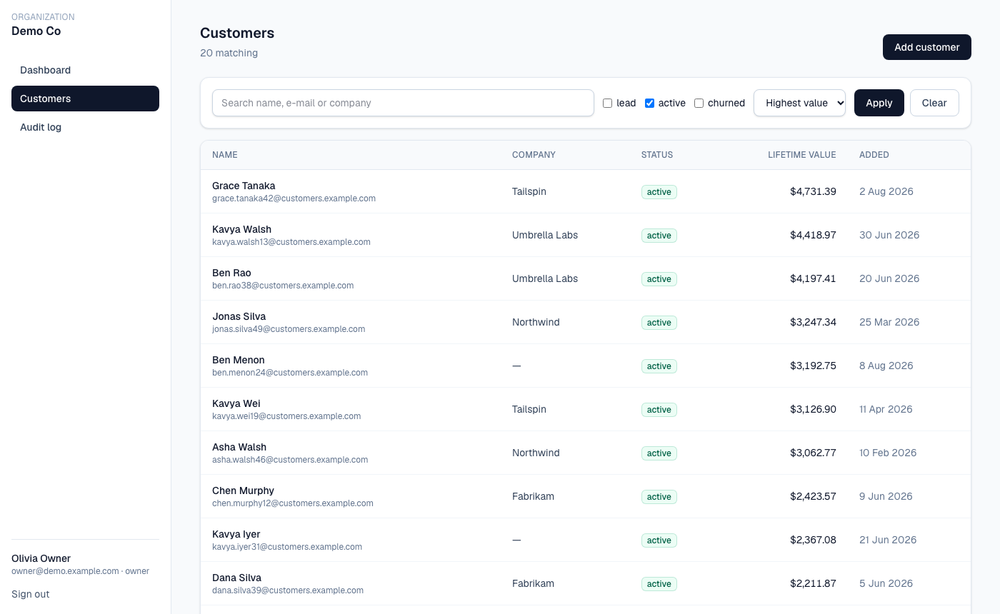
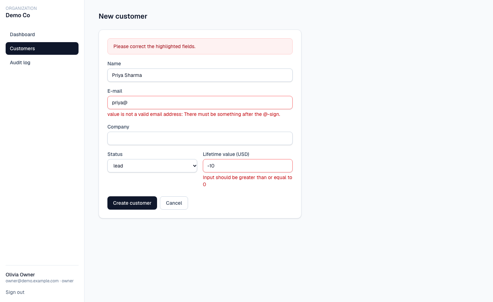
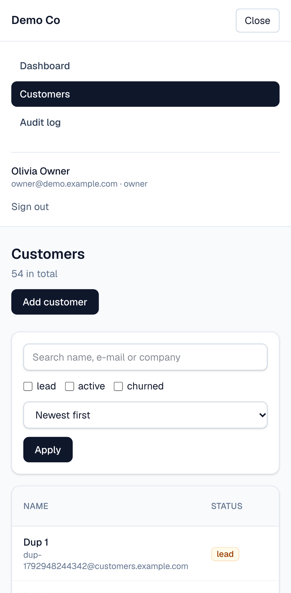
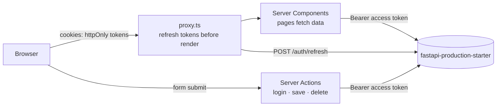

# SaaS Admin Dashboard

A Next.js 16 + TypeScript admin frontend for [fastapi-production-starter](https://github.com/shijinb/fastapi-production-starter): sign-in, a KPI dashboard, a searchable and filterable customer table with pagination, create/edit/delete forms with server-side validation, an audit log, and a responsive layout. Tested with unit tests and end-to-end browser tests against the real API.

[](https://github.com/shijinb/saas-admin-dashboard/actions/workflows/ci.yml)




| Customer list (filter, sort, paginate) | Validation errors from the API | Mobile |
|---|---|---|
|  |  |  |

All names and figures in the screenshots are synthetic demo data from the API's seed script.

## Quick start

```bash
# 1. API (separate repository): Postgres + migrations + API on :8000, then demo data
git clone https://github.com/shijinb/fastapi-production-starter.git && cd fastapi-production-starter
docker compose up -d --build && docker compose run --rm api python -m scripts.seed && cd ..

# 2. Dashboard
git clone https://github.com/shijinb/saas-admin-dashboard.git && cd saas-admin-dashboard
npm ci
cp .env.example .env.local        # API_URL=http://localhost:8000
npm run dev                       # http://localhost:3000
```

Sign in as `owner@demo.example.com`, `admin@demo.example.com` or `member@demo.example.com` with the seed password `demo-password-change-me`.

## Features

| Area | Details |
|---|---|
| **Dashboard** | Total, active, lifetime value and new-in-30-days figures; status breakdown; recently added customers |
| **Customer table** | Search (name, e-mail, company), multi-status filter, six sort orders, pagination with page window; state lives in the URL, so views are shareable and filters work without JavaScript |
| **Forms** | Create and edit with Server Actions; the API's validation errors (RFC 9457 problem details) appear on the matching fields, typed values are kept, duplicate e-mails are reported on the e-mail field |
| **Roles** | Members don't see the audit log or the delete button; the API enforces the same rules, so hiding them is only a convenience |
| **States** | Loading skeletons, empty states (no data vs. no matches), error boundary with retry, not-found page for unknown or other tenants' records |
| **Responsive** | Sidebar becomes a menu on small screens; the table scrolls inside its container instead of widening the page |
| **Accessibility** | Labelled inputs, `aria-invalid` and `aria-describedby` on errors, `aria-current` in navigation and pagination, `role=alert` for form errors |

## Architecture



**Backend-for-frontend.** The browser never sees an API token. Login runs in a Server Action that stores the access and refresh tokens in `httpOnly`, `SameSite=Lax` cookies. Server Components and Server Actions read them and call the API server-to-server. The API URL is never shipped to the client.

**Session refresh.** `src/proxy.ts` (Next.js 16's renamed middleware) checks the access token's expiry before each page render and, when fewer than 30 seconds remain, exchanges the refresh token for a new pair. One page load sends several requests at once (the page plus link prefetches), so concurrent refreshes with the same token share one API call (`src/lib/refresh.ts`). Across several dashboard instances, the API's refresh grace window covers the rest. This combination came out of the end-to-end tests: without it, users were logged out whenever their token was renewed during a page load.

**Authorization lives in the API.** The proxy only decides whether to send someone to `/login`. Every data call carries the user's token and is checked by the API, including inside Server Actions.

### Design choices

- **Cache Components off.** The Next.js 16 scaffold enables Cache Components and partial prefetching. Every page here shows per-user data fetched at request time, so they would add Suspense and caching rules without a benefit. All API calls use `cache: "no-store"`.
- **Plain GET form for filters.** No client state library: the URL is the state, parsed and validated by `parseListQuery()`.
- **No UI library.** Tailwind CSS v4 utility classes and a handful of small components (`src/components/ui.tsx`).
- **`output: "standalone"`** for a small production image.

```
src/
  proxy.ts                    token refresh before render (Next.js 16 proxy)
  app/
    login/                    page + client form (useActionState)
    (app)/                    signed-in area: layout (sidebar), dashboard, customers, audit,
                              loading / error / not-found states
  components/                 sidebar, customer form, small UI primitives
  lib/
    api.ts                    server-only API client, problem-details → ApiError
    actions.ts                Server Actions: login, logout, save, delete
    refresh.ts                de-duplicated token refresh
    tokens.ts                 cookie names/options, JWT expiry helpers
    list-query.ts             URL ⇄ list state, pagination window, formatting
tests/
  unit/                       Vitest (20 tests)
  e2e/                        Playwright (12 tests, desktop + mobile)
```

## Configuration

| Variable | Default | Notes |
|---|---|---|
| `API_URL` | `http://localhost:8000` | Base URL of the API; read on the server only |
| `COOKIE_SECURE` | `true` when `NODE_ENV=production` | Set `false` only for plain-HTTP runs (local e2e); some browsers refuse `Secure` cookies on `http://localhost` |

## Testing

```bash
npm run lint && npm run typecheck && npm test      # ESLint, tsc, 20 Vitest unit tests

# End-to-end: needs the API running with seed data (see Quick start)
npm run build
cp -r .next/static .next/standalone/.next/ && cp -r public .next/standalone/
API_URL=http://127.0.0.1:8000 COOKIE_SECURE=false PORT=3100 node .next/standalone/server.js &
E2E_BASE_URL=http://127.0.0.1:3100 npm run test:e2e
```

- **Unit:** token expiry and refresh timing, cookie lifetimes, de-duplicated refresh (concurrency, caching window, failures not cached), URL query parsing with hostile input, pagination window, API client headers and problem-details mapping.
- **End-to-end** (real API and PostgreSQL): redirect to login and back to the requested page, wrong password, open-redirect protection, cookies are `httpOnly` and invisible to page scripts, sign-out, dashboard figures match the list, filter/sort via URL, create with validation errors, edit, delete, audit entry, duplicate e-mail, not-found for unknown IDs, member restrictions, mobile menu and no horizontal overflow.

**Verification status (2026-10-25):** lint, typecheck, 20 unit tests and `next build` pass locally (Node 24). The 12 end-to-end tests passed twice in a row against fastapi-production-starter 1.1.0 with PostgreSQL 15 and **1-minute access tokens**, so token refresh ran throughout. The Dockerfile has not been built locally (Docker was not available); CI runs the build, unit and end-to-end jobs.

## Deployment

```bash
docker build -t saas-admin-dashboard .
docker run -p 3000:3000 -e API_URL=https://api.example.com saas-admin-dashboard
```

Serve it over HTTPS (cookies are `Secure` in production) and put it on the same site as, or a trusted network path to, the API. A worked AWS deployment of both services is planned for the `aws-deployment-lab` repository.

## Limitations

- English only; currency is shown in USD.
- No user-management screens yet (the API supports them).
- The customer list re-renders on the server for every filter change; for very large tables, add debounced client-side search.
- The Docker image is built in CI only (see verification status).

## License

MIT; see [LICENSE](LICENSE).
